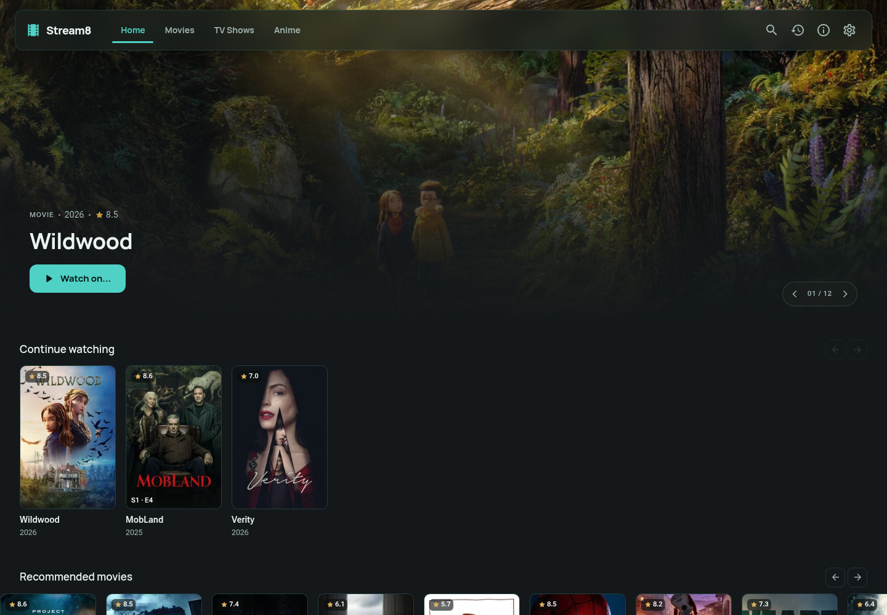
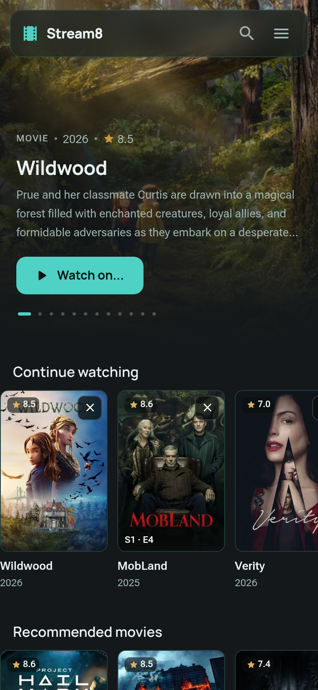
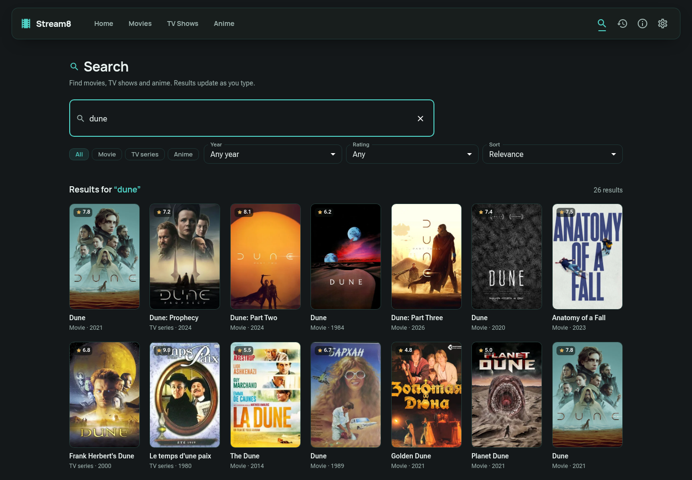
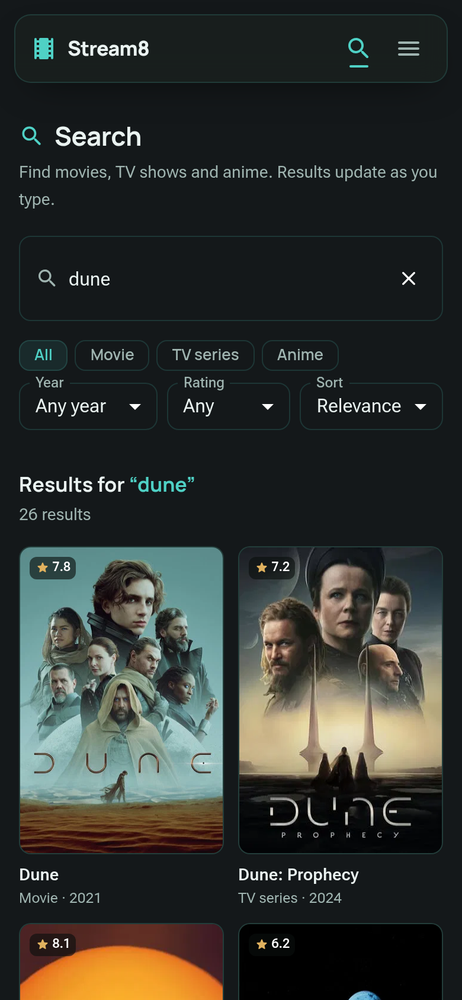
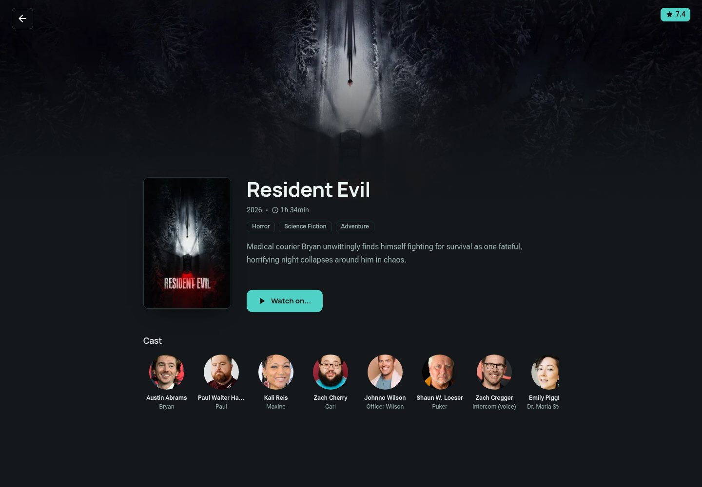
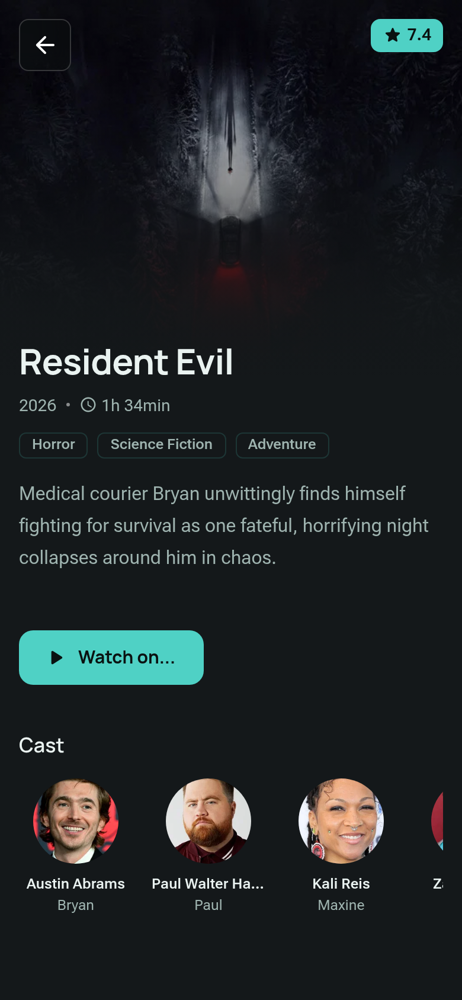

# 🎬 Stream8

<p align="center">
  
</p>

<p align="center">
  <strong>Discover movies, TV shows and anime. Keep your watch history. Jump to the service you already use.</strong>
</p>

<p align="center">
  <a href="https://stream8.poppi.cc"></a>
  <a href="LICENSE"></a>
</p>

**Stream8** is a local-first streaming aggregator and tracker for movies, TV shows and anime. It uses TMDb for discovery and metadata, keeps settings and watch history in your browser, and opens the service you choose — a mainstream platform or a custom source such as your own Jellyfin/Plex server.

🌐 **Live app:** [stream8.poppi.cc](https://stream8.poppi.cc)

> Stream8 does not host, distribute or stream any video content. It only displays public metadata and builds links to services you configure. See the [disclaimer](#-disclaimer).

---

## ✨ Features

- **Discover and search** — featured titles, recommendations and multi-search for movies, TV shows and anime, powered by TMDb.
- **Watch history on your terms** — history is opt-in and stays on your device. Resume from “Continue watching”, group episodes by show, and import/export everything as JSON.
- **“Watch on…”** — checks TMDb/JustWatch availability for the mainstream services you selected, then opens the provider link or a title search on that service.
- **Custom sources** — connect a service you already use (Jellyfin, Plex, a personal server…) with URL patterns built from `{tmdb_id}`, `{season}`, `{episode}`, `{anilist_id}`, `{mal_id}` and `{title}`. AniList is queried on demand only when a pattern needs those IDs.
- **Optional cross-device sync** — connect a self-hosted [Stream8 Sync](https://github.com/rizzonicola/stream8-sync) server to merge history across devices. No Stream8 server is involved, and sync is off by default.
- **Installable PWA** — standalone window, home-screen shortcuts and an offline app shell. Dynamic API responses are never cached, so metadata stays fresh.
- **Privacy by default** — no analytics, advertising, tracking cookies or third-party scripts. Settings and custom services remain local; history is stored only after explicit consent.
- **Made to feel native** — responsive layouts, light/dark/AMOLED themes, Italian/English/French UI, keyboard navigation and reduced-motion support.

---

## 📸 Screenshots

| Home — desktop | Home — mobile |
| :---: | :---: |
|  |  |

| Search — desktop | Search — mobile |
| :---: | :---: |
|  |  |

| Detail — desktop | Detail — mobile |
| :---: | :---: |
|  |  |

---

## 🧱 Tech stack

| Layer | Technology |
| --- | --- |
| UI | React 18, Material UI 5, Emotion, Manrope / Roboto Flex |
| Build | Vite 5 |
| Hosting | Cloudflare Pages + Pages Functions |
| Data | TMDb API, AniList GraphQL (on demand) |
| Offline | Service Worker + Web App Manifest |
| Tests | Node.js built-in test runner (`node --test`) |

### Project structure

```text
functions/api/tmdb/[[path]].js  Token-safe TMDb proxy (Cloudflare Pages Function)
public/                         PWA manifest, service worker, icons, headers
src/api/                        TMDb client and on-demand AniList resolver
src/components/                 UI components, hero, cards and dialogs
src/context/                    Settings, history and privacy consent
src/pages/                      Home, detail, history, settings, info
test/                           Unit tests
```

---

## 🚀 Getting started

### Prerequisites

- Node.js **20 or newer**
- npm
- A [TMDb](https://www.themoviedb.org/) **API Read Access Token v4** (it starts with `eyJ...`)

### Local development

```bash
git clone https://github.com/rizzonicola/stream8.git
cd stream8
npm install

cp .dev.vars.example .dev.vars
# Edit .dev.vars and set TMDB_TOKEN=your_v4_read_access_token
```

Start the local Pages Function and the Vite dev server in two terminals:

```bash
# Terminal 1 — TMDb proxy on http://127.0.0.1:8788
npm run dev:api

# Terminal 2 — app on http://127.0.0.1:5173
npm run dev
```

Open [http://localhost:5173](http://localhost:5173). Vite proxies `/api` to the Pages Function, so the token never enters the browser bundle.

> **Never rename the token to `VITE_TMDB_TOKEN`.** Vite would inline any `VITE_*` variable into the client bundle.

### Available scripts

| Command | Description |
| --- | --- |
| `npm run dev` | Start the Vite dev server with HMR |
| `npm run dev:api` | Serve the TMDb Pages Function locally on port `8788` |
| `npm run build` | Create the production build in `dist/` |
| `npm test` | Run the unit test suite |
| `npm run preview:pages` | Build, then serve `dist/` with Pages Functions via Wrangler |

---

## ☁️ Deployment

Stream8 is designed for **Cloudflare Pages**:

1. Create a Pages project and connect this repository.
2. Set the build command to `npm run build` and the output directory to `dist`.
3. Add an **encrypted** environment variable named `TMDB_TOKEN` with your TMDb v4 Read Access Token.
4. Deploy. Pages automatically picks up the Function in `functions/`.

The deployment configuration also includes:

- `public/_routes.json` — invokes the Function only for `/api/*`, keeping the rest of the site static.
- `public/_redirects` — SPA fallback to `index.html` for client-side routes.
- `public/_headers` — CSP and security headers (HSTS, `X-Frame-Options`, `Permissions-Policy`, etc.).

---

## 🔒 Privacy and security

- **No Stream8 backend.** The app runs entirely in the browser; the only server-side component is the TMDb proxy hosted alongside the static site.
- **Token stays server-side.** The browser calls `/api/tmdb/*`; the Pages Function adds the `Authorization` header and keeps `TMDB_TOKEN` in Cloudflare secrets. The proxy only accepts the endpoints and parameters the app actually uses, and caches responses at the edge for five minutes.
- **History is optional.** It is written to `localStorage` only after explicit consent and can be cleared at any time. Settings are stored locally because the app cannot work without them.
- **External requests are limited to what you use.** TMDb metadata requests are always required; AniList is contacted only when a custom service pattern needs AniList/MAL IDs; the sync server is contacted only if you enable sync.
- **No tracking.** No analytics, ads, tracking cookies or third-party scripts.

---

## 🧪 Tests

```bash
npm test
```

The suite covers URL safety, custom-service configuration, history normalization and merging, LRU caching, settings sharing, the sync client, the TMDb client and the proxy allowlist.

---

## ⚖️ Disclaimer

Stream8 is a neutral software tool. It displays public title information from TMDb and builds links to streaming services or custom sources chosen by the user. It does not host, distribute or provide any audiovisual content, and it does not approve or encourage unauthorized access to copyrighted material.

The “custom service” feature lets you connect any address you enter (for example your own Jellyfin or Plex server). You are solely responsible for ensuring that the source is legal and for complying with the copyright laws applicable in your country. The optional sync feature requires a server that you install and operate yourself; its security, availability and legality are your responsibility.

This product uses the TMDb API but is not endorsed or certified by TMDb. It also uses the public AniList API for on-demand anime ID resolution but is not endorsed or certified by AniList. Third-party names and trademarks belong to their respective owners and are used for identification purposes only.

---

## 📄 License

Distributed under the **GNU General Public License v3.0 (GPLv3)**. See [LICENSE](LICENSE) for the full text.
